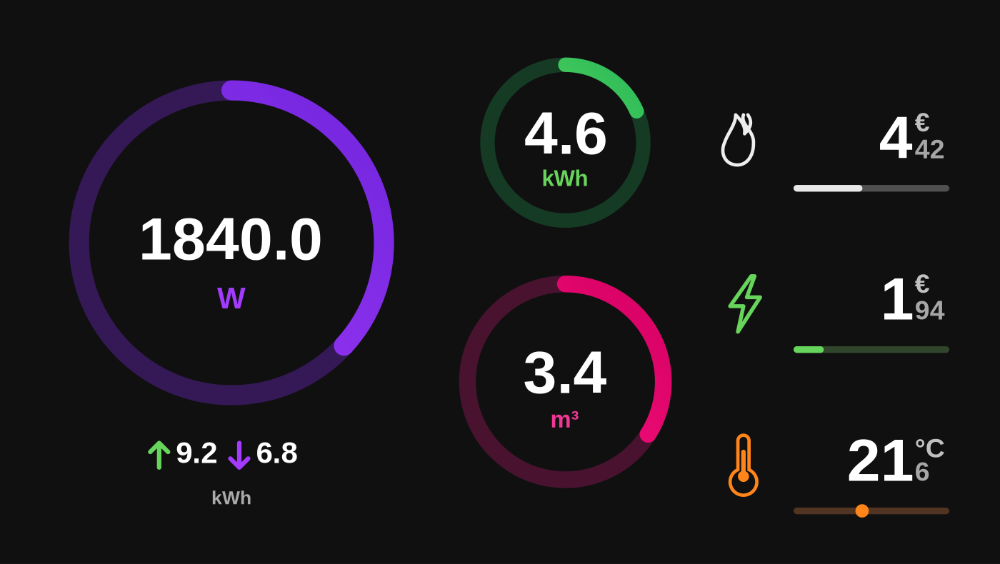

# HomeWizard Energy Dashboard

A full-screen Home Assistant dashboard for live energy, water and climate data, drawn as a single SVG with gauges, a status column and daily totals.

Built for wall tablets and kiosk browsers: one panel view, no page scrolling, and it scales to whatever screen it lands on. It inherits whatever theme your Home Assistant profile uses.



Sample values shown: 1.84 kW import, 4.6 kWh self-use, 3.4 m³ gas, €4.42 gas costs, €1.94 electricity costs, 21.6 °C.

## What you get

- **Main gauge** for live power, with a green arc and an arrow when you are exporting instead of importing.
- **Two middle gauges** for a secondary live value and a second daily total.
- **Right-hand column** with three values, each with its own icon, unit and progress bar.
- **Daily import/export totals** under the main gauge, shown only when the main gauge is live electricity.
- **One card, one file.** Everything is inside a single `html-template-card` template, so there is nothing to install besides that card.

## Example setups

The view is a plain panel, so it fits wherever a browser can show a Home Assistant dashboard. Here is how it behaves in each setup, and what to expect.

### Casting to a Nest Hub (tested)

The author runs this card combined with [Continuously Casting Dashboard](https://github.com/b0mbays/continuously-casting-dashboard), which keeps a dashboard open on a Google Nest Hub Gen 2 and re-casts it when it drops. The 1024×600 screen shows the whole layout without scrolling thanks to the panel view.

Worth knowing before you copy that setup:

- The Nest Hub is a display, not a tablet. Touching the screen does not navigate, so treat the dashboard as read-only and point the cast at this view directly.
- Cast sessions end when the Hub goes idle or reboots. The casting integration is what brings them back — hence "continuous".
- The Hub dims on its own schedule. Adjust the ambient/screen settings in the Google Home app if the dashboard disappears too soon.

### Wall tablet or old phone in kiosk mode (untested)

An old phone or tablet running a kiosk browser — Fully Kiosk Browser, WallPanel, or the Home Assistant Companion app in kiosk mode — is the classic use for this layout. Point the browser at the dashboard URL and the panel view fills the screen.

Expect to tune it: a phone in portrait crops the three-column layout badly, so use landscape, and hide the browser chrome in the kiosk settings. Dark theme suits a wall display better than light.

### Desktop or laptop (untested)

It works as a full-window dashboard, but a 16:9 monitor at desk distance leaves the gauges enormous. Handy for a second monitor that stays on the energy page.

### Where it does not fit

- Not a dashboard for phones you carry around. No navigation, no buttons, no history graphs.
- Not multi-view. It is one view showing now, today, and nothing else.

If you run it somewhere else and it looks good, open an issue or a PR and it can move from untested to tested.

## Requirements

| Requirement | Notes |
|---|---|
| Home Assistant | Any recent version, dashboard in storage or YAML mode |
| [HTML Template Card](https://github.com/PiotrMachowski/Home-Assistant-Lovelace-HTML-Jinja2-Template-card) | `custom:html-template-card`, available in HACS |
| Energy sensors | Numeric (`W`, `kWh`, `m³`, `L`, `°C`, `%`, `€`) |

## Installation

The dashboard is one view made of one card, so setup takes about two minutes and needs no YAML files.

### 1. Install the card

HACS → **Frontend** → search for **HTML Template Card** → install, then reload the browser.

Manual install: drop `html-template-card.js` into `config/www/` and register it as a module resource.

### 2. Create a view

Open the dashboard where you want it — a new one, or any existing dashboard in **storage mode**.

1. Click **Edit dashboard** in the top right corner.
2. Click **Add view**.
3. Click the **three dots** in the top right corner of the view editor and choose **Edit in YAML**.
4. Delete whatever is in the box and paste the entire contents of [`dashboard.yaml`](dashboard.yaml).
5. Click **Save**, then **Done**.

That is the base done: the view exists, the panel layout is set and the card renders. It will show placeholders until you point it at your own sensors — see [Configuration](#configuration).

> The view is defined as `type: panel`, so it always fills the screen. If you paste it into an existing dashboard, it simply becomes one more tab in the sidebar.

### Alternative: YAML mode dashboard

If you keep your dashboards in YAML files instead of the UI, add the dashboard in `configuration.yaml`:

```yaml
lovelace:
  dashboards:
    homewizard:
      mode: yaml
      title: HomeWizard
      icon: mdi:transmission-tower
      show_in_sidebar: true
      filename: homewizard-dashboard.yaml
```

Then create `homewizard-dashboard.yaml` in your config folder next to it, with the view pasted straight in:

```yaml
views:
  - type: panel
    path: homewizard
    title: HomeWizard
    # ...rest of dashboard.yaml
```

Or keep the view in its own file and include it:

```yaml
views:
  - !include views/homewizard.yaml
```

Restart Home Assistant, then open **HomeWizard** in the sidebar. Both example files are in [`examples/`](examples/).

## Configuration

All of it happens in two places inside `dashboard.yaml`:

1. **Measurement registry** — describe each sensor once: name, entity, unit, icon, category, gauge maximum, decimals.
2. **Display assignments** — pick which measurement IDs appear in which position.

```jinja






```

| Position | Renders |
|---|---|
| `main_gauge` | Large central gauge, up to 5000 W by default |
| `upper_middle` | Upper middle circular gauge |
| `lower_middle` | Lower middle circular gauge |
| `right_top` | Top row of the right column |
| `right_middle` | Middle row of the right column |
| `right_bottom` | Bottom row, with a dot marker instead of a bar |

The two daily totals under the main gauge are fixed to `electricity_generation_today` and `electricity_consumption_today`, and only appear when `main_gauge` is `electricity_now`.

Scale overrides let you stretch a gauge without touching the registry. `0` means "use the registry value":

```jinja



```

Full details in [docs/configuration.md](docs/configuration.md).

## Entities

Every entity ID in the template matches its friendly name, so the dashboard reads like the sensor list in Home Assistant. See [docs/measurements.md](docs/measurements.md) for the full table, and rename yours to match, or edit the `entity:` lines to point at what you have.

## Icons

`bolt`, `solar`, `flame`, `water`, `thermometer`, `battery`, and anything else falls through to a generic bolt. All icons are inline SVG, so they work without any icon set.

## Repository layout

```text
dashboard.yaml               the view, ready to use
examples/
  configuration-lovelace.yaml  lovelace block for configuration.yaml
  homewizard-dashboard.yaml    dashboard file with the view included
  sensors-sample.yaml          template sensors for testing
docs/
  configuration.md             registry, assignments, overrides, colours
  measurements.md              every measurement and its entity ID
  troubleshooting.md           common problems and fixes
```

## Troubleshooting

Blank card, `unavailable` values, clipping on odd screen sizes: [docs/troubleshooting.md](docs/troubleshooting.md).

## Contributing

Issues and pull requests are welcome, see [CONTRIBUTING.md](CONTRIBUTING.md).

## License

MIT, see [LICENSE](LICENSE).
